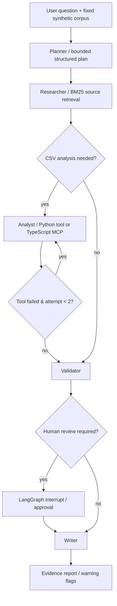

# Scientific Research Copilot · LangGraph / RAG / MCP / FastAPI

**A portfolio-ready, evidence-first multi-agent workflow MVP**, focused on scientific document retrieval and conductivity CSV analysis. Python owns the LangGraph orchestration and REST API; TypeScript implements a real read-only MCP server; tests and an evaluation CLI separate demonstrated behavior from unverified claims.

> **Research & accuracy disclosure:** All 6 source notes and all 6 experimental records are **synthetic educational examples**. There are **no real paper/PDF ingestion claims**, scientific predictions, real business deployments, production SLAs, model-training results, or invented improvements. The default response is an offline extractive preview, not model generation. Optional model-based drafting and MCP execution require configuration and independent testing.

## Screenshot-free working demo

Start locally, then open `http://127.0.0.1:8000/demo` for a responsive browser workflow console, or `http://127.0.0.1:8000/docs` for OpenAPI.

```bash
python -m venv .venv
source .venv/bin/activate       # Windows: .venv\Scripts\activate
pip install -e '.[dev]'
pytest -q
python -m sciwork.evaluation --save results/offline_eval.json
uvicorn sciwork.api:app --reload
```

Run a complete research-and-analysis workflow:

```bash
curl -s http://127.0.0.1:8000/chat -H 'Content-Type: application/json' \
  -d '{"question":"Compare LLZO oxide and sulfide moisture sensitivity; screen CSV conductivity >= 0.0004"}'
```

For **HITL**, send `{"question":"LLZO oxide processing", "require_review":true}`. Save the `thread_id`, then run:

```bash
curl -s -X POST http://127.0.0.1:8000/runs/REPLACE_THREAD_ID/resume \
  -H 'Content-Type: application/json' -d '{"approved":true}'
```

For **SSE node updates**, call `POST /chat/stream` with the same JSON and inspect `event: node` / `event: complete`.

## Architecture



### Module responsibilities

| Component | Implementation | Engineering decisions |
|---|---|---|
| Planner | Deterministic task routing in `core.py` | Reproducible; intentionally not an autonomous free-form LLM planner |
| Researcher | BM25 lexical retrieval; corpus IDs | Offline RAG (retrieval + grounded evidence synthesis); no misleading embedding claims |
| Analyst | `analysis.py`, optional `mcp_client.py` | Cross-language read-only MCP tool; explicit backend flag; no silent fallback |
| Validator | Temperature comparison warning, insufficient evidence and tool errors | Does not fabricate scientific rankings |
| Human review | `interrupt` / `Command(resume=...)` | Real LangGraph paused state, single-process demo |
| Writer | Extractive evidence report / opt-in LLM | Guard against unknown citation IDs; synthetic-data disclosure |
| API | FastAPI, SSE, OpenAPI | `thread_id`, conflict handling, health endpoint |
| Evaluation | Curated 12-case synthetic retrieval set | Hit@3 plus correct abstentions; median local retrieval latency; no business KPIs |

## TypeScript MCP server

```bash
cd mcp-server
npm install
npm run build
cd ..
export SCIW_USE_MCP=true
uvicorn sciwork.api:app --reload
```

This invokes a **real MCP stdio protocol session** from Python using `mcp.ClientSession`, starts a Node MCP server using the official TypeScript v2 SDK and calls `analyze_experiments`. The server reads an operator-configured CSV only; users cannot request arbitrary file access. Use Node 22+ and TypeScript SDK v2. `SCIW_USE_MCP=true` **fails visibly** on errors instead of silently substituting Python results. In Docker, the Node server is included in the image.

## Optional LLM generation

```bash
export SCIW_MODEL_MODE=openai
export SCIW_OPENAI_API_KEY='...'
export SCIW_OPENAI_MODEL='gpt-4.1-mini'
```

This uses an OpenAI-compatible `/chat/completions` API for **report synthesis**, not model-directed agentic planning. It validates source ID tokens and falls back to extractive evidence output if unavailable/invalid. Do not upload keys, private documents, or unlicensed third-party PDFs.

## Evaluation & known limitations

- The `data/eval_demo.jsonl` test set was written against the same synthetic collection, so its results **cannot be interpreted as external generalization**.
- Offline BM25 retrieval uses lexical matching, not semantic embeddings; relevance filtering is a heuristic, not calibrated confidence.
- No real PDF parsing, domain-specific data extraction, multi-agent emergent collaboration, inference training, or scientific calculator integration is included.
- Checkpointing is in-memory; restart loses pending HITL approval and conversations. It is **not production persistence**. Use Postgres/Redis plus authentication for actual deployments.
- No auth, tenant isolation, quotas, rate limiting, large-file upload or distributed tracing default. Expose only on trusted networks. SSE progress is demonstration-grade and not replayable.
- MCP's demo parser supports simple comma-separated CSV only (no quoted commas); Python's parser is more complete. Schema is validated and tools are read-only.
- LangSmith tracing may be configured via environment separately, but this repository does not claim it has been activated and benchmarked.
- CI is configured to test Python, LangGraph HITL/API and TypeScript compilation on GitHub runners. Actual green status must be checked after the workflow runs.

## Development test commands

```bash
pytest -q
python -m sciwork.evaluation --save results/offline_eval.json
cd mcp-server && npm run build
```

## Roadmap

1. Add real publication DOI metadata, license-safe PDF ingestion and page-level citations.
2. Add embedding+BM25 hybrid retrieval and independently authored evaluation data.
3. Add persisted checkpoint storage, async job queue, auth and structured tracing.
4. Add true domain-science tool integration and unit-aware normalization.
5. Benchmark single-agent baseline against the current explicit graph, including run cost and P95 latency.

## Useful references

- [LangGraph Graph API](https://docs.langchain.com/oss/python/langgraph/graph-api)
- [LangGraph persistence](https://docs.langchain.com/oss/python/langgraph/add-memory)
- [MCP TypeScript SDK v2](https://ts.sdk.modelcontextprotocol.io/v2/)
- [MCP Python SDK](https://github.com/modelcontextprotocol/python-sdk)

## License

MIT. See `LICENSE`.
