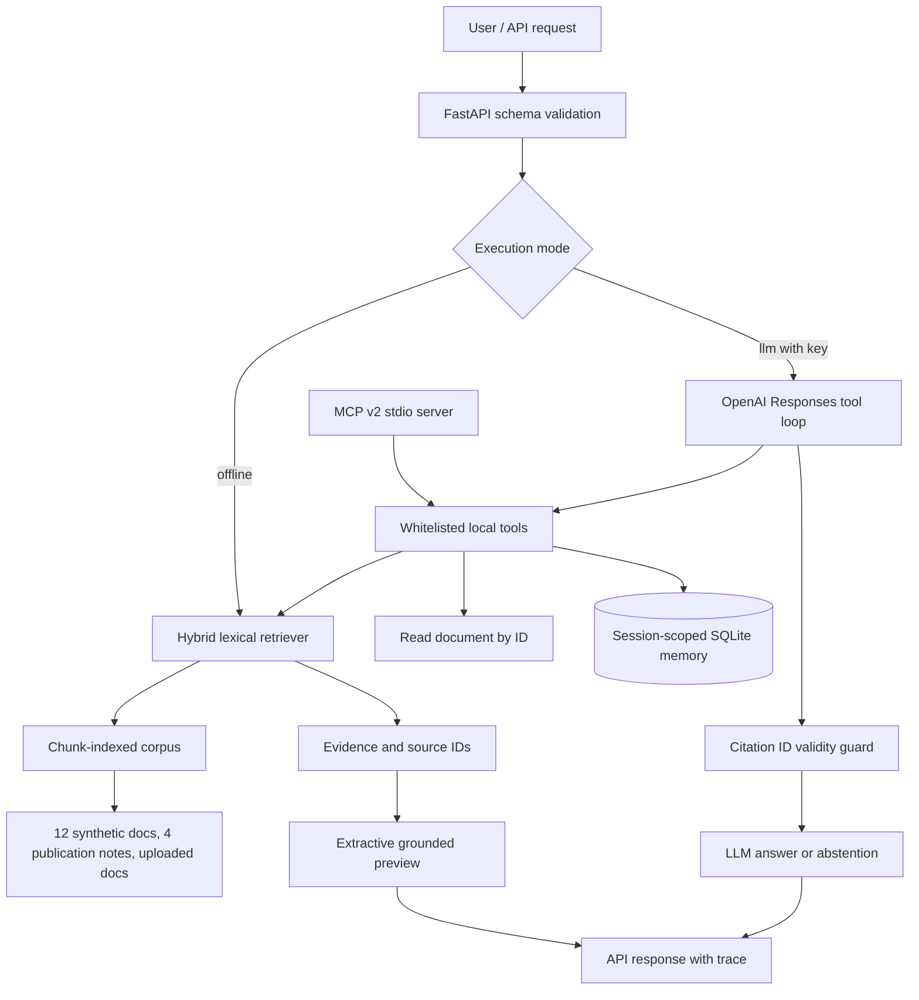

# Architecture and design decisions

## Why these choices

- **TF-IDF word + character**: fast, reproducible bilingual baseline, no API key. Not a dense embedding model and not a learned reranker.
- **Optional vector module**: real vector cosine retrieval with OpenAI embeddings (API key/billing needed). Isolated for straightforward comparison; its live network integration has not been validated here.
- **MCP**: independently expose read-only search and document tools to compatible clients. MCP is not itself an LLM or an agent.
- **LLM tool loop**: Responses API returns model-chosen function calls; application executes only allowlisted tools; tool outputs returned by call_id; max 5 rounds; error handling; final citations checked against retrieved doc IDs.
- **Context vs memory**: retrieval context is source evidence; user notes are stored per session in SQLite. Memory can be incomplete or stale and is not proof.
- **Evaluation**: retrieval Hit@3, MRR and out-of-domain abstention. A small synthetic dataset is only a smoke benchmark, not a production KPI.
- **Service**: FastAPI validation, automatic OpenAPI docs. Dockerfile is a build recipe; no cloud deployment, auth, observability, or load testing has been performed.

## Main engineering gaps before production

1. Ingestion permissions and citation provenance: current citations are filenames/chunk IDs, not verified DOI/patent records.
2. Fine-grained claim-level factuality: checking referenced IDs is weaker than verifying every generated claim.
3. Authentication, per-user authorization, encrypted state, consent and retention policies for memory.
4. Model cost, retries/backoff, idempotency, per-tool timeout, telemetry, p95 latency and redaction.
5. Robust PDF reading (tables, formulas, images, OCR), extraction validation and document provenance.
6. Real external evaluation data and independently labeled outcomes, plus independent answer judge.
7. More rigorous agentic planning and parallelism after obtaining representative workloads.

## What counts as complete in this repository

Verified: offline hybrid retrieval, extractive citation response, session memory, API, unit tests and deterministic retrieval evaluation.

Code included but **needs external validation**: model-driven Responses API loop, remote embedding integration, MCP 2.x server, Docker image runtime. No synthetic source is a real patent or measured experimental paper.
